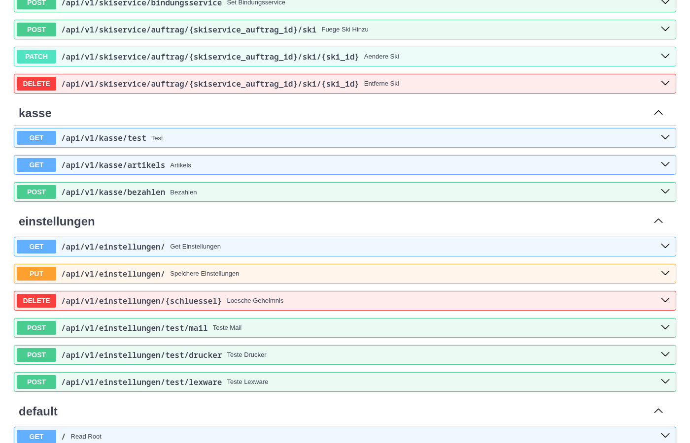

# Skiservice API

Zentrales Backend der Skiservice-Anwendung. Alle Frontends sprechen ausschließlich mit dieser API:

| Repository | Aufgabe |
|---|---|
| **skiserviceapi** (dieses) | FastAPI-Backend, Datenbank, PDF, Etiketten, Mail, Lexware |
| [skiservice-center](https://github.com/SimonLoeffler1993/skiservice-center) | Verwaltung für Mitarbeiter: Kunden, Skiservice, Saison- und Tagesverleih, Material, Preise, Einstellungen |
| ski-kunden-dialog | Kundenterminal (Tablet): Kunden erfassen und prüfen ihre Daten selbst |
| [ski-pos-kasse](https://github.com/SimonLoeffler1993/ski-pos-kasse) | Kasse |



## Funktionen

- **Kunden** mit Postleitzahlen-Verzeichnis (wird beim Start eingespielt)
- **Skiservice-Aufträge**: anlegen, bearbeiten (Ski hinzufügen/ändern/entfernen, Abholdatum), löschen, fertigmelden mit Mail an den Kunden
- **Bindungsdaten** (Fahrer, Sohlenlänge, Gewicht, Größe, Fahrkönnen, Alter) je Ski in der Tabelle `bindungsdaten`, mit Verweis auf den Kunden: `GET /kunden/{id}/bindungsdaten` liefert alle Einträge eines Kunden, alte Einträge lassen sich archivieren. Die Werte stehen auch auf dem Ski-Etikett
- **Saison- und Tagesverleih**: eigener Nummernkreis je Art (`25/26SV12`, `25/26TV3`), Belegungsprüfung beim Tagesverleih, Vertrag als PDF (WeasyPrint, ohne externen Dienst)
- **Kasse**: offene Aufträge und Verleihe, Bezahlen in einer Transaktion, Quittung als PDF
- **Etikettendruck** auf Brother-QL-Druckern (QR-Code je Ski)
- **Lexware Office**: Bezahlstatus von Belegen
- **Einstellungen** in der Datenbank, pflegbar im Skiservice Center
- **Echtzeit**: Server-Sent Events zum Kundenterminal, WebSocket für den Ski-Scanner

- **Material** (Ski, Schuhe, Stöcke, Hersteller, Skiarten, Modelle): bearbeiten und löschen. Hersteller, Skiarten und Modelle lassen sich nur löschen, wenn nichts mehr darauf verweist (bei Skiarten auch keine Saisonverleih-Preise).
  - Steckt Ski, Schuh oder Stock in einem Verleih, kann er nicht gelöscht, nur **ausgemustert** werden (`PATCH …/ausgemustert`). Er verschwindet dann aus der Auswahl, bestehende Verleihe bleiben vollständig.
  - `GET …/verwendung` listet die Verleihe, in denen er steckt.
  - Die Ski-Nr. ist änderbar, Verleihe ziehen über `ON UPDATE CASCADE` automatisch mit.
  - Schuhe haben eine eigene, eindeutige Schuh-Nr. (Standard: interne ID), z. B. für Inventur-Aufkleber. Verleihe verweisen intern auf die ID.

Bezahlte Aufträge und Verleihe sind gegen Ändern und Löschen gesperrt (HTTP 409). Nur Kommentar, Bemerkung und Fahrername bleiben änderbar.

## Konfiguration

Über Umgebungsvariablen (oder `app/.env`) wird **nur die Datenbank** eingestellt:

| Variable | Standard |
|---|---|
| `DB_HOST` | `localhost` |
| `DB_PORT` | `3306` |
| `DB_USER` | `root` |
| `DB_PASSWORD` | `password` |
| `DB_NAME` | `skiservice` |

Alle anderen Einstellungen (Firma, Etikettendrucker, SMTP, Lexware, Nummernkürzel …) stehen in der Tabelle `einstellungen` und werden im Skiservice Center unter **Verwalten → Einstellungen** gepflegt. Welche Einstellungen es gibt, ist in [`app/services/einstellungen.py`](app/services/einstellungen.py) definiert; im Code werden sie mit `einstellungen.hole("SCHLUESSEL")` gelesen.

**Umstieg von älteren Versionen:** Beim Start werden fehlende Einstellungen einmalig aus gleichnamigen Umgebungsvariablen übernommen (z. B. `SMTP_SERVER`, `SMTP_PASSWORD`, `LEXWARE_APIKEY`, `LABELPRINTERIDENT`, `HOST`). Danach können diese Variablen entfernt werden.

### E-Mail

Unterstützt werden drei Arten der Verschlüsselung (Einstellung `SMTP_MODUS`):

| Modus | Üblicher Port | Einsatz |
|---|---|---|
| `ssl` | 465 | SMTP über SSL |
| `starttls` | 587 | Exchange / Office 365 und die meisten Anbieter |
| `keine` | 25 | interner Exchange-Relay |

Ist kein Benutzer eingetragen, wird ohne Anmeldung versendet (Relay).

## Entwicklung

```bash
python -m venv .venv
source .venv/bin/activate
pip install -r requirements.txt

alembic upgrade head          # Datenbankschema anlegen / aktualisieren
python -m app.checkplzs       # Postleitzahlen einspielen
python -m app.add_skitype     # Skiarten einspielen

./startdev.sh                 # uvicorn mit Reload auf Port 8000
```

Die API-Dokumentation steht danach unter <http://localhost:8000/docs>.

### Datenbank-Migrationen

Das Schema wird ausschließlich über Alembic verwaltet:

```bash
alembic revision --autogenerate -m "beschreibung"
alembic upgrade head
alembic check                 # prüft, ob Models und Datenbank übereinstimmen
```

### Aufbau

```
app/
├── api/v1/      Router (in main.py registriert, alle unter /api/v1)
├── services/    Geschäftslogik über mehrere Schritte (Aufträge, Kasse, Quittung, Einstellungen)
├── crud/        Datenbankabfragen
├── models/      SQLAlchemy-Models
├── schemas/     Pydantic-Schemas für Anfragen und Antworten
├── utils/       Etiketten, PDF, Mail, Lexware, SSE-/WebSocket-Manager
└── templates/   Jinja2-Vorlagen für PDF und Mail
```

## Betrieb mit Docker

Bei jedem Push auf `master` baut GitHub Actions das Image `ghcr.io/simonloeffler1993/skiserviceapi:latest`.

Beim Start des Containers ([`entrypoint.sh`](entrypoint.sh)):

1. auf die Datenbank warten
2. `alembic upgrade head`
3. Postleitzahlen und Skiarten einspielen
4. uvicorn auf Port 8000 starten

Den kompletten Stack (API, Center, Kundenterminal, MariaDB) startet [`docker/alles/docker-compose.yml`](docker/alles/docker-compose.yml) mit der Vorlage [`docker/alles/.env.beispiel`](docker/alles/.env.beispiel).

> **Wichtig:** Die API muss mit **genau einem Worker** laufen. Die Verbindungen zu Kundenterminals (SSE) und Ski-Scannern (WebSocket) werden im Arbeitsspeicher gehalten.

> **Sicherheit:** Die API hat noch keine Anmeldung und erlaubt Anfragen von jedem Ursprung (CORS `*`). Sie darf nur im internen Netz erreichbar sein.
